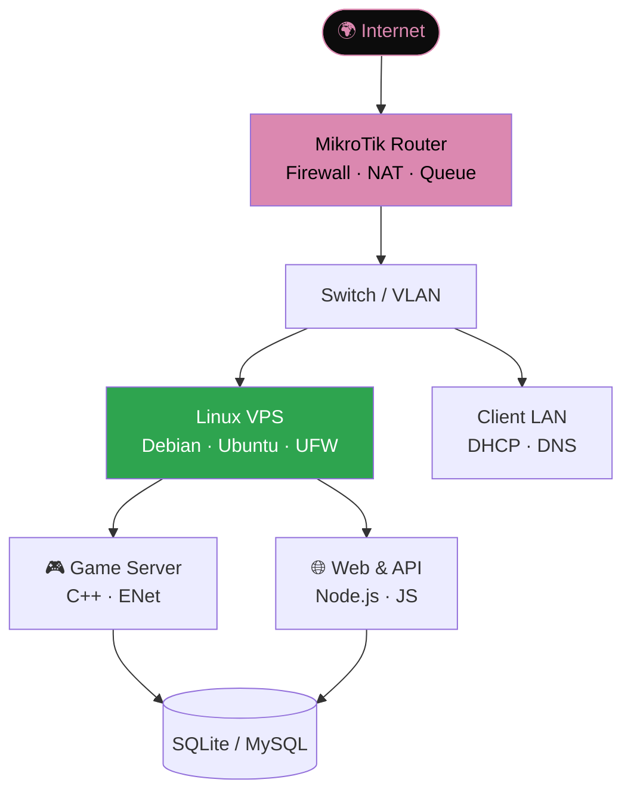

<div align="center">

```
 ____  _
|  _ \(_) __ _ ______ _
| |_) | |/ _` |_  / _` |
|  _ <| | (_| |/ / (_| |
|_| \_\_|\__, /___\__,_|
            |_|
```

**`network engineer` · `game server dev` · `web developer`**

[](https://riqza.my.id)
[](https://riqza.my.id)
[](https://linkedin.com/in/riqza-muhammad-alfanahal)
[](https://instagram.com/riqzabojong_)

</div>

---

### `~/neofetch`

```text
rqzaa@github
------------
Name      : Riqza Muhammad Alfanahal
Handle    : @rqzaa  (RzGans)
School    : SMK Global Persada (TJKT)
Cert      : MTCNA — 96/100 (IDN Networking)
Exp       : 4+ yrs Game Server Dev (2021–2025)
Intern    : Teknisi Komputer @ Mangga Dua (2026)
Langs     : C++ · Node.js · JavaScript · Python · TypeScript
Infra     : MikroTik RouterOS · Linux (Debian/Ubuntu) · VPS
DB        : SQLite · MySQL
Site      : https://riqza.my.id
```

### `~/about.md`

- 👋 Hi, I'm **@rqzaa**
- 👀 I'm interested in **networking (MikroTik), game servers, dan web dev**
- 🌱 I'm currently learning **Linux server/VPS, security, dan web modern**
- 💞️ I'm looking to collaborate on **project web, automation, dan game server**
- 📫 How to reach me: **[riqza.my.id](https://riqza.my.id)**
- 😄 Pronouns: **he/him**
- ⚡ Fun fact: **Ngoding game server sejak 2021, lalu lulus MTCNA dengan skor 96**

### `~/topology.md`

Cara saya melihat sebuah sistem: dari kabel sampai aplikasi.



### `~/projects`

| | Project | Stack |
|---|---|---|
| 🌐 | [**rzgans.xyz**](https://rzgans.xyz) — website utama personal | `HTML` `CSS` `JS` |
| 🤖 | [**ai.rzgans.xyz**](https://ai.rzgans.xyz) — platform berbasis AI | `AI` `JS` `API` |
| 📁 | [**riqz.my.id**](https://riqz.my.id) — kumpulan seluruh project | `AI` `JS` `API` |
| 🎮 | [**gacha.rzgans.xyz**](https://gacha.rzgans.xyz) — web game gacha | `JS` `CSS` |

### `~/log`

```text
2026-01 → 2026-03   PKL Teknisi Komputer, Mangga Dua
                    └─ rakit PC, install OS, perbaikan hardware, maintenance

2025                MTCNA — 96/100, IDN Networking (8 minggu intensif)
                    └─ RouterOS, firewall, routing, troubleshooting

2021 → 2025         Game Server Dev (GTPS)
                    └─ C++ core, ENet, anti-exploit, Discord bot, VPS & anti-DDoS
```

### `~/stack`

<div align="center">


</div>

### `~/contact`

```bash
$ open https://riqza.my.id            # portfolio
$ open https://instagram.com/riqzabojong_
$ open https://tiktok.com/@rqza_
$ open https://linkedin.com/in/riqza-muhammad-alfanahal
$ open https://threads.net/@riqzabojong_
```

<div align="center">
<br>
<sub><code>$ echo "Dari fondasi jaringan sampai level aplikasi."</code></sub>
</div>
