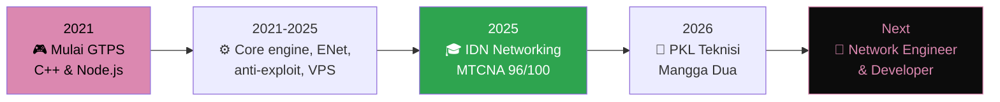

<div align="center">


<a href="https://riqza.my.id">
  
</a>

<br><br>

<a href="https://riqza.my.id"></a>


<a href="https://linkedin.com/in/riqza-muhammad-alfanahal"></a>


</div>

<br>

## 🙋‍♂️ About Me

<table>
<tr>
<td width="220" align="center">
  
  <br><br>
  <b>Riqza</b><br>
  <sub>@rqzaa • RzGans</sub>
</td>
<td>

- 👋 Hi, I'm **@rqzaa** (Riqza Muhammad Alfanahal)
- 👀 I'm interested in **jaringan komputer (MikroTik), game server development, dan web development**
- 🌱 I'm currently learning **Linux server/VPS, security, dan web modern**
- 💞️ I'm looking to collaborate on **project web, tools/automation, dan game server**
- 📫 How to reach me: **[riqza.my.id](https://riqza.my.id)** atau sosial media di bawah
- 😄 Pronouns: **he/him**
- ⚡ Fun fact: **Ngoding game server sejak 2021, lalu lulus MTCNA dengan skor 96!**

</td>
</tr>
</table>

Saya siswa jurusan **Teknik Jaringan Komputer dan Telekomunikasi (TJKT)** di **SMK Global Persada**. Lewat program **IDN Networking**, saya meraih sertifikasi **MTCNA (MikroTik Certified Network Associate)**. Kombinasi networking dan software development membuat saya paham sistem dari fondasi jaringan sampai level aplikasi.

```bash
$ whoami
riqza — network engineer & developer

$ cat skills.txt
networking  : MikroTik, TCP/IP, VLAN, Firewall/NAT, Wireshark
backend     : C++, Node.js, Python, SQLite, MySQL
frontend    : HTML5, CSS3, JavaScript (ES6+), TypeScript
sysadmin    : Linux (Debian/Ubuntu), SSH, UFW/iptables, VPS
hardware    : PC assembly, cabling (RJ45/T568), fiber optic basics

$ echo $STATUS
"Learning, building, and shipping." 🚀
```

<br>

## 🛠️ Tech Stack

<div align="center">

<a href="https://skillicons.dev">
  
</a>

</div>

<details>
<summary><b>🌐 Networking & Infrastruktur</b> (klik untuk buka)</summary>
<br>


</details>

<details>
<summary><b>💻 Software & Game Server</b> (klik untuk buka)</summary>
<br>


</details>

<details>
<summary><b>🔧 Hardware & Sysadmin</b> (klik untuk buka)</summary>
<br>


</details>

<br>

## 🚀 Featured Projects

<table>
<tr>
<td width="50%" valign="top">

### 🌐 [rzgans.xyz](https://rzgans.xyz)
Website utama personal, portal berbagai fitur dan informasi.
<br><sub><code>HTML</code> <code>CSS</code> <code>JavaScript</code></sub>

</td>
<td width="50%" valign="top">

### 🤖 [ai.rzgans.xyz](https://ai.rzgans.xyz)
Platform berbasis AI, eksplorasi kecerdasan buatan lewat web.
<br><sub><code>AI</code> <code>JavaScript</code> <code>API</code></sub>

</td>
</tr>
<tr>
<td width="50%" valign="top">

### 📁 [riqz.my.id](https://riqz.my.id)
Website yang mengumpulkan seluruh project saya.
<br><sub><code>AI</code> <code>JavaScript</code> <code>API</code></sub>

</td>
<td width="50%" valign="top">

### 🎮 [gacha.rzgans.xyz](https://gacha.rzgans.xyz)
Web game gacha interaktif dengan mekanik gacha yang seru.
<br><sub><code>Game</code> <code>JavaScript</code> <code>CSS</code></sub>

</td>
</tr>
</table>

<br>

## 🗺️ Perjalanan Saya



| Periode | Peran | Detail |
|---|---|---|
| 2026 | 🔧 **Teknisi Komputer (PKL)**, Mangga Dua, Jakarta | Perakitan PC, instalasi OS, perbaikan hardware, maintenance (Jan–Mar, 3 bulan) |
| 2025 | 🎓 **MTCNA, skor 96/100**, IDN Networking | 8 minggu pelatihan intensif: RouterOS, firewall, routing, troubleshooting |
| 2021–2025 | 🎮 **Game Server Developer (GTPS)** | C++ core engine, ENet packet handling, anti-exploit, Discord bot, database, Linux VPS |

<br>

## 📸 Galeri

<details>
<summary><b>🎓 IDN Networking</b> (klik untuk buka)</summary>
<br>
<p align="center">
  
  
  
</p>
</details>

<details>
<summary><b>🔧 PKL Mangga Dua</b> (klik untuk buka)</summary>
<br>
<p align="center">
  
  
  
</p>
</details>

<br>

## 📊 GitHub Stats

<div align="center">


</div>

<br>

## 📫 Let's Connect

<div align="center">

<a href="https://riqza.my.id"></a>
<a href="https://instagram.com/riqzabojong_"></a>
<a href="https://tiktok.com/@rqza_"></a>
<a href="https://linkedin.com/in/riqza-muhammad-alfanahal"></a>
<a href="https://threads.net/@riqzabojong_"></a>
<a href="https://facebook.com/riqza.xeky"></a>

<br><br>

> *"Dari fondasi jaringan sampai level aplikasi."*

<sub>⭐ Suka profil ini? Kunjungi <a href="https://riqza.my.id">riqza.my.id</a> untuk portfolio lengkap ✨</sub>


</div>
