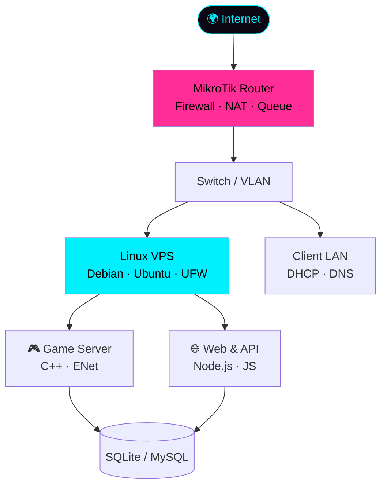

<div align="center">


<br>

<a href="https://riqza.my.id"></a>


</div>

## ▓▒░ ABOUT ░▒▓

- 👋 Hi, I'm **@rqzaa** (Riqza Muhammad Alfanahal)
- 👀 I'm interested in **jaringan komputer (MikroTik), game server development, dan web development**
- 🌱 I'm currently learning **Linux server/VPS, security, dan web modern**
- 💞️ I'm looking to collaborate on **project web, tools/automation, dan game server**
- 📫 How to reach me: **[riqza.my.id](https://riqza.my.id)**
- 😄 Pronouns: **he/him**
- ⚡ Fun fact: **Ngoding game server sejak 2021, lalu lulus MTCNA dengan skor 96**

Siswa **TJKT** di **SMK Global Persada**, dari fondasi jaringan sampai level aplikasi.

<div align="center"></div>

## ▓▒░ PLAYER CARD ░▒▓

<div align="center">

| 🎮 PLAYER | **RIQZA** |
|:--|:--|
| **CLASS** | Network Engineer / Game Server Dev |
| **GUILD** | SMK Global Persada · TJKT |
| **ACHIEVEMENT** | 🏆 MikroTik MTCNA — 96/100 |
| **EXPERIENCE** | ⚔️ 4+ tahun GTPS (C++ & Node.js) |
| **QUEST LOG** | 🔧 PKL Teknisi Komputer, Mangga Dua (2026) |
| **SIDE QUESTS** | 🌐 4 web project live |
| **STATUS** | 🟢 Online · Open to collaborate |

</div>

<div align="center"></div>

## ▓▒░ SKILL TREE ░▒▓

<div align="center">


<br><br>


</div>

<div align="center"></div>

## ▓▒░ NETWORK MAP ░▒▓



<div align="center"></div>

## ▓▒░ MISSIONS ░▒▓

<table>
<tr>
<td width="50%" valign="top">

### 🌐 [rzgans.xyz](https://rzgans.xyz)
Website utama personal.
<br><sub><code>HTML</code> <code>CSS</code> <code>JS</code></sub>

</td>
<td width="50%" valign="top">

### 🤖 [ai.rzgans.xyz](https://ai.rzgans.xyz)
Platform berbasis AI.
<br><sub><code>AI</code> <code>JS</code> <code>API</code></sub>

</td>
</tr>
<tr>
<td width="50%" valign="top">

### 📁 [riqz.my.id](https://riqz.my.id)
Website seluruh project saya.
<br><sub><code>AI</code> <code>JS</code> <code>API</code></sub>

</td>
<td width="50%" valign="top">

### 🎮 [gacha.rzgans.xyz](https://gacha.rzgans.xyz)
Web game gacha interaktif.
<br><sub><code>Game</code> <code>JS</code> <code>CSS</code></sub>

</td>
</tr>
</table>

<div align="center"></div>

## ▓▒░ TIMELINE ░▒▓

```text
2026-01 → 2026-03   PKL Teknisi Komputer, Mangga Dua
                    └─ rakit PC, install OS, perbaikan hardware, maintenance

2025                MTCNA 96/100, IDN Networking (8 minggu intensif)
                    └─ RouterOS, firewall, routing, troubleshooting

2021 → 2025         Game Server Dev (GTPS)
                    └─ C++ core, ENet, anti-exploit, Discord bot, VPS & anti-DDoS
```

<div align="center"></div>

## ▓▒░ CONNECT ░▒▓

<div align="center">

<a href="https://riqza.my.id"></a>
<a href="https://instagram.com/riqzabojong_"></a>
<a href="https://tiktok.com/@rqza_"></a>
<a href="https://linkedin.com/in/riqza-muhammad-alfanahal"></a>
<a href="https://threads.net/@riqzabojong_"></a>

<br><br>

<sub><code>$ echo "Dari fondasi jaringan sampai level aplikasi."</code></sub>

</div>

