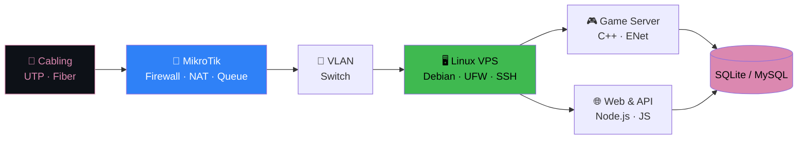

<div align="center">


<a href="https://riqza.my.id">
  
</a>

<br>

<a href="https://riqza.my.id"></a>


<a href="https://linkedin.com/in/riqza-muhammad-alfanahal"></a>


</div>

<br>

## 🙋‍♂️ About Me

<table>
<tr>
<td width="230" align="center" valign="top">
  
  <br><br>
  <b>Riqza</b><br>
  <sub>@rqzaa · RzGans</sub><br><br>
  
</td>
<td valign="top">

- 👋 Hi, I'm **@rqzaa** (Riqza Muhammad Alfanahal)
- 👀 I'm interested in **jaringan komputer (MikroTik), game server development, dan web development**
- 🌱 I'm currently learning **Linux server/VPS, security, dan web modern**
- 💞️ I'm looking to collaborate on **project web, tools/automation, dan game server**
- 📫 How to reach me: **[riqza.my.id](https://riqza.my.id)** atau sosial media di bawah
- 😄 Pronouns: **he/him**
- ⚡ Fun fact: **Ngoding game server sejak 2021, lalu lulus MTCNA dengan skor 96!**

</td>
</tr>
</table>

Siswa jurusan **Teknik Jaringan Komputer dan Telekomunikasi (TJKT)** di **SMK Global Persada**. Lewat program **IDN Networking**, saya meraih sertifikasi **MTCNA (MikroTik Certified Network Associate)**. Kombinasi networking dan software development membuat saya memahami sistem dari fondasi jaringan sampai level aplikasi.

```routeros
[riqza@MikroTik] > /system resource print
  platform: TJKT · SMK Global Persada
  uptime: 4y+  (game server dev since 2021)
  cpu: C++ · Node.js · JavaScript · Python
  certificate: MTCNA 96/100  (IDN Networking)
  location: Indonesia 🇮🇩
```

<br>

## 🛠️ Tech Stack

<div align="center">


</div>

<details open>
<summary><b>🌐 Networking & Infrastruktur</b></summary>
<br>


</details>

<details>
<summary><b>💻 Software & Game Server</b></summary>
<br>


</details>

<details>
<summary><b>🔧 Sysadmin & Hardware</b></summary>
<br>


</details>

<br>

## 🛰️ Dari Kabel sampai Aplikasi



<br>

## 🚀 Featured Projects

<table>
<tr>
<td width="50%" valign="top">

### 🌐 [rzgans.xyz](https://rzgans.xyz)
Website utama personal, portal berbagai fitur dan informasi.
<br><sub><code>HTML</code> <code>CSS</code> <code>JavaScript</code></sub>

</td>
<td width="50%" valign="top">

### 🤖 [ai.rzgans.xyz](https://ai.rzgans.xyz)
Platform berbasis AI, eksplorasi kecerdasan buatan lewat web.
<br><sub><code>AI</code> <code>JavaScript</code> <code>API</code></sub>

</td>
</tr>
<tr>
<td width="50%" valign="top">

### 📁 [riqz.my.id](https://riqz.my.id)
Website yang mengumpulkan seluruh project saya.
<br><sub><code>AI</code> <code>JavaScript</code> <code>API</code></sub>

</td>
<td width="50%" valign="top">

### 🎮 [gacha.rzgans.xyz](https://gacha.rzgans.xyz)
Web game gacha interaktif dengan mekanik gacha yang seru.
<br><sub><code>Game</code> <code>JavaScript</code> <code>CSS</code></sub>

</td>
</tr>
</table>

<br>

## 🏆 Sertifikasi & Pengalaman

| Periode | Peran | Yang dikerjakan |
|:--|:--|:--|
| **2026** (Jan–Mar) | 🔧 **Teknisi Komputer (PKL)**<br><sub>Mangga Dua, Jakarta</sub> | Perakitan PC, instalasi OS & software, perbaikan hardware, maintenance perangkat pelanggan |
| **IDN Networking** | 🎓 **MTCNA, skor 96/100**<br><sub>8 minggu pelatihan intensif</sub> | MikroTik RouterOS, firewall, routing, troubleshooting jaringan |
| **2021–2025** | 🎮 **Game Server Developer (GTPS)**<br><sub>C++ & Node.js</sub> | Core engine, ENet packet handling, anti-exploit, Discord bot, database, Linux VPS & mitigasi DDoS |

<br>

## 📸 Galeri

<details>
<summary><b>🎓 IDN Networking</b></summary>
<br>
<p align="center">
  
  
  
</p>
</details>

<details>
<summary><b>🔧 PKL Mangga Dua</b></summary>
<br>
<p align="center">
  
  
  
</p>
</details>

<br>

## 📊 GitHub Stats

<div align="center">


</div>

<br>

## 📫 Let's Connect

<div align="center">

<a href="https://riqza.my.id"></a>
<a href="https://instagram.com/riqzabojong_"></a>
<a href="https://tiktok.com/@rqza_"></a>
<a href="https://linkedin.com/in/riqza-muhammad-alfanahal"></a>
<a href="https://threads.net/@riqzabojong_"></a>
<a href="https://facebook.com/riqza.xeky"></a>

<br><br>

> *"Dari fondasi jaringan sampai level aplikasi."*


</div>
